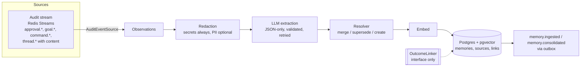
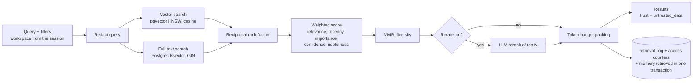
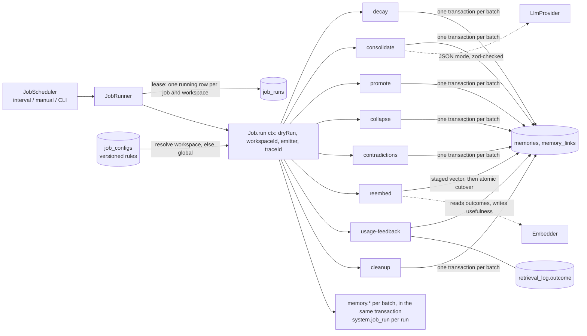
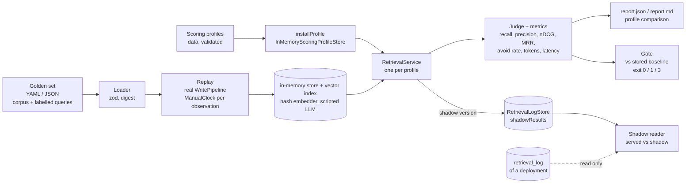

# Architecture

proba-memory is the memory service of Proba. It lives next to the audit service and the Hub, but it is a
separate system with its own store: **audit is the record of what happened, memory is what the system
learned from it.** Memory reads the audit stream (and other sources), writes to Postgres + pgvector, and
answers retrieval requests with scored, explainable results.

- Categories: `working`, `episodic`, `semantic`, `procedural`, `super`.
- Sources: goals, approvals, message threads, audit and analytics logs.
- Three parts: **ingestion and indexing** (apps/memory-ingestor), **background jobs** (apps/memory-jobs),
  **retrieval** with a configurable scoring formula (apps/memory-api).
- Built in M1: the foundation, the write path, retrieval, the read API and the **decay** job. Built in M2: the
  seven **memory lifecycle jobs** and their versioned rules. M3 part A adds the **evaluation harness**
  (apps/memory-eval). Extension points exist for M4 (portal screens, including the screens on top of the harness);
  they are listed at the end.

## Layout and layering

```
packages/scoring     pure functions: scoring profile schema, normalisation, recency, RRF, MMR, token packing
packages/core        domain types, ports (interfaces), write path, retrieval service, audit emitter/outbox/relay,
                     config, logger, job runner, adapter registry. No I/O libraries.
packages/adapters    implementations of the ports: Postgres+pgvector, Redis Streams, OpenAI-compatible embedder
                     and LLM (DeepSeek preset), audit/content sources, auth, rate limiters, in-process versions,
                     and the registries that pick them by config
apps/memory-api      Fastify read API (search, get, list, profiles) + operator search CLI
apps/memory-ingestor sources -> write path; seed CLI
apps/memory-jobs     job scheduler and runner; the eight jobs; versioned job config; run-job and job-config CLIs
apps/memory-eval     evaluation harness: golden sets, metrics, backtest, profile comparison, regression gate, shadow logs
migrations/postgres  numbered SQL, applied by `npm run migrate`
```

Dependencies point one way: `scoring` ← `core` ← `adapters` ← `apps`; `memory-eval` is an app and no other app
imports it. Apps never construct an adapter
directly: `createRuntime(config, { needs })` asks the registries for the adapter named in config and
only creates the ports the app asked for (the API has no LLM unless rerank is on, for example).

## Write path (ingestion and indexing)



Properties that the tests pin down:

- **Idempotent by observation id.** The id is a deterministic UUID of (source, external id). A claim state
  machine (`pending` → `processed` or `skipped`, with a claim so only one worker runs it) lets redeliveries and concurrent workers do nothing.
- **One transaction.** Memory rows, source links, supersede/contradict links, the vector index entries and the
  audit event commit together. If the audit event cannot be recorded, nothing is written and the observation
  stays pending for redelivery.
- **Redaction before anything leaves the process.** Secrets (API keys, tokens, passwords, private keys) are
  always masked; email and phone numbers are masked when `REDACT_PII=true` (default). The LLM and the
  embedder only see redacted text, the model's output is redacted again, and stored observations hold the
  redacted text. Conversation text from audit `content` is treated as sensitive: it goes only into the
  observation text, never into logs, audit events or `facts`.
- **Prompt hardening.** Observations are given to the model as JSON data with `<` escaped inside a single
  delimited block; the system prompt says the block is data; the model gets no tools. Its output must match a
  schema (no `super` category, ranges checked), otherwise the call is retried with the validation error and
  finally fails (the observation stays pending and is dead-lettered by the source after
  `BUS_MAX_DELIVERIES`).
- **Resolver.** Cosine similarity ≥ `RESOLVER_SIMILARITY_THRESHOLD` (default 0.9) against active memories of the
  same workspace and category is the same fact: same stance merges (evidence count +1, confidence up, clock
  reset), opposite stance supersedes (old memory `superseded` with `validTo`, `supersedes` and `contradicts`
  links). ≥ `RESOLVER_RELATED_THRESHOLD` (0.75) only adds a `supports`/`contradicts` link. Never hard-delete.
- **Delivery.** The ingestor acks after the pipeline finishes. A failure leaves the item pending; reclaim
  redelivers; after the maximum deliveries the source dead-letters it (the dead letter never keeps `content`).

### Audit `content` (conversation text)

Since protocol v0.3.3 an audit event can carry an optional admin-only `content` (raw text of user messages,
brain replies, clarifications and explanations, secrets masked, with a content digest). `AuditEventSource` uses it as
the **source of conversation text**: `thread.message_received`, `brain.reply_generated`,
`brain.explanation_generated` and `brain.clarification_requested` events become observations **only when
`content` is present**; without it they carry nothing to learn from and are ignored. Content of kind `prompt`
(model input) is never used. `approval.*`, `goal.*`, `command.*`, `control.*` and `brain.decision_made` are
observations from their structured fields as before.

There is **no Hub content feed**. Conversation text reaches memory only through audit events with
`AUDIT_CONTENT_ENABLED` on the Hub (and the consumer). The `HubContentSource` port remains only for the
local development source (`HUB_CONTENT_SOURCE=dev`, refused in production unless `ALLOW_DEV_CONTENT_SOURCE=true`)
when `SOURCES` includes `content`; it is not a production path and no Hub HTTP feed is planned.

## Read path (retrieval)



- **Hard filters first.** Workspace (from the session, never the request), status (`active` unless an admin asks
  otherwise), category, goal, thread, confidence, time window.
- **Score** = Σ weight × feature, features in 0..1: relevance (fused rank score), recency (exponential decay by
  category half-life, measured from the last reinforcement), importance, confidence, usefulness.
  Default weights 0.5 / 0.15 / 0.15 / 0.1 / 0.1.
- **Profiles are data.** `scoring_profiles` holds immutable versions (weights, half-lives, fusion constants, MMR
  lambda, pool sizes, packing, rerank). A version moves `draft → shadow → canary → active → retired`. A shadow
  version is scored on every request and logged next to the served one but never returned; a canary serves
  `canaryPercent` of requests, chosen by a hash of the trace id. A workspace uses its own profile family once it
  has an active version, otherwise the global (`*`) one.
- **Every retrieval is logged** (`retrieval_log`): query (redacted) and hash, filter, profile and version, every
  candidate with its features, ranks, score, position or drop reason (`below_min_score`, `outside_pool`,
  `diversity`, `over_limit`, `over_budget`), results, and shadow results. It is audited as `memory.retrieved`
  with ids and counts only. The log row, the access counters and the outbox event commit together; if auditing
  fails the read fails (**fail closed**).
- **Degrades, does not break.** Vector index down → full-text results with `degraded: vector_search_unavailable`;
  rerank failure → score order with `degraded: rerank_unavailable`.
- **Retrieved text is untrusted data.** Every result carries `trust: "untrusted_data"`; consumers must treat it
  as data to quote, never as instructions. The API returns it as JSON and never interprets it.

## Memory lifecycle

```mermaid
stateDiagram-v2
  [*] --> working: write path (short-lived context)
  [*] --> episodic: write path (an observed event)
  working --> tombstoned: cleanup (TTL or validTo passed)
  episodic --> semantic: consolidate (cluster summarised, sources superseded)
  episodic --> tombstoned: cleanup (stale and low importance)
  semantic --> procedural: promote (repeated, confirmed, old enough)
  procedural --> super: promote (stricter thresholds)
  semantic --> super: promote (stricter thresholds)
  semantic --> superseded: collapse (same meaning, winner kept)
  semantic --> superseded: contradictions (loser of a clear decision)
  semantic --> tombstoned: cleanup (stale and low importance)
  procedural --> superseded: collapse / contradictions
  super --> superseded: collapse / contradictions
  superseded --> [*]: kept for history and provenance
  tombstoned --> [*]: kept; never retrieved, never deleted
```



Category moves are one-way and always leave the source rows in place: consolidate and promote create a new
memory and supersede the old ones (`supersedes` links, `provenance.derivedFrom`), collapse keeps the best
duplicate, contradictions either supersede the loser or keep both linked with `contradicts`. `status` is
`active`, `superseded` or `tombstoned`; nothing is hard-deleted. Confidence and usefulness change along the way
(collapse raises it on reinforcement and lowers it on contradiction, usage feedback learns usefulness from
approvals and rejections, decay lowers it with time); re-embed changes only the vector.

## Background jobs



Every job implements core's `Job`, is created by `createJobs`, and gets the lease, the schedule, the audit
events, the structured logs, the `--dry-run` switch and per-workspace isolation from the runner. The runner only
visits workspaces that exist; a job receives one `workspaceId` and every store call is scoped by it.

**Rules in the database.** `job_configs` holds one immutable row per version of (workspace, job); publishing
retires the active version in the same step. Workspace `*` is the global version; a workspace row overrides it for
that workspace. Each job parses its row with a zod schema whose defaults are the seed (`npm run job-config -- seed`,
or the first non-dry run). A row that fails validation fails the run loudly. Details of every run and audit
event carry `configVersion`.

| Job | Idempotency | Core rules (all configurable) |
| --- | --- | --- |
| consolidate | deterministic id for the summary from the sorted source ids; sources leave `active` in the same transaction | similarity threshold, time window, min and max cluster size, minimum age |
| promote | deterministic id from source id and target category; source superseded in the same transaction | per target: evidence count, confidence, age, weighted evidence (agreeing approvals and rejections count `decisiveWeight` times, disagreeing ones subtract), decisive signals, usefulness; blocked by an active contradiction |
| collapse | superseded duplicates leave the candidate set; an `adjustments` ledger in provenance counts each supporting or contradicting link once | duplicate threshold, merge, support and contradiction deltas, floor and ceiling |
| contradictions | a resolved pair is no longer both active; an unresolved pair keeps one `contradicts` link (upsert) | related threshold, weights for recency, evidence strength and source, decisive margin |
| reembed | only active memories not yet at the target; staging is an upsert; cutover swaps nothing while any is pending | per-run cap, auto cutover |
| usage-feedback | the outcome is recorded once (first wins) and applied once (atomic claim in the same transaction as the updates) | outcome window, learning rate, position discount |
| cleanup | tombstoned rows leave the candidate set | working TTL, stale categories, importance ceiling, idle days |

**Usage feedback** reads each retrieval's trace id, finds the approval or rejection observations recorded under
it after the retrieval (workspace-scoped), takes the first, and moves each returned memory's `usefulness`
toward 1 (approved) or 0 (rejected) by `learningRate`, discounted by result position. A retrieval with no
decision after the window is closed with outcome `none` and changes nothing. The scoring profile's `usefulness`
feature reads this column, so retrieval learns from approvals without a code change.

**Re-embed rollout order (no downtime).** Vector search only compares vectors of the same model and version, so
the served vector must not change until every active memory has its replacement.
1. Run the job with the NEW embedder settings (`EMBEDDER_*`, same `EMBEDDING_DIMENSION`) while the API and the
   ingestor still use the old ones (`npm run job -- reembed`, or the scheduled run). It embeds batches into
   `embedding_next*`; retrieval keeps using `embedding`.
2. When no active memory is pending, it swaps staged to current in one atomic transaction (or an operator runs it
   with `autoCutover: false`).
3. Move the API and ingestor to the new settings. Memories written between the cutover and this step carry the
   old model and are picked up by the next run.
A different dimension needs a column migration first; the job refuses a vector of the wrong length.

**Decay** lowers `confidence` and `importance` of active memories exponentially toward floors
(`DECAY_CONFIDENCE_FLOOR`, `DECAY_IMPORTANCE_FLOOR`), measured from the later of the last reinforcement and the
last decay, so runs do not compound and a run right after another changes nothing. Half-lives per category:
working 1 day, episodic 14, semantic 180, procedural 365, super 730 (`DECAY_HALF_LIFE_DAYS` overrides);
importance fades `DECAY_IMPORTANCE_HALF_LIFE_MULTIPLIER` (2) times slower. Rows moving less than
`DECAY_MIN_CHANGE` are skipped without resetting their clock. It never deletes, retires or changes content.
Decay stays configured by env (`DECAY_*`); the seven M2 jobs read the database.

**Prompt safety.** The consolidation prompt marks memory text as data inside a JSON document and the reply is
validated against a schema; text that tries to instruct the model is treated as a note to summarise. The reply
is redacted before it is stored, and a reply that fails validation is retried up to `JOBS_LLM_MAX_ATTEMPTS` times,
then the cluster is skipped for this run.

## Evaluation harness

`apps/memory-eval` (details and usage: [EVALUATION.md](EVALUATION.md)) measures retrieval quality offline. It adds no
port and no table: it composes the existing ones.



- **Same code as production.** The harness builds the write path (`MemoryExtractor`, `MemoryResolver`,
  `WritePipeline`) and `RetrievalService` from the in-process adapters (`HashEmbedder`, `ScriptedLlmProvider`,
  `InMemoryMemoryStore`, `InMemoryVectorIndex`, `InMemoryScoringProfileStore`, `InMemoryRetrievalLogStore`,
  `ManualClock`, `SequentialIdGenerator`) exactly as the memory-flow tests do. It never reads `process.env`
  for providers, so it cannot reach a real model or database by accident. Only `shadow --source=runtime` builds a
  runtime from config, and only to read the retrieval log and memories.
- **Deterministic.** Fixed clock, sequential ids, hash embedding, scripted extraction: the same golden set and
  profiles give the same report, except latency (wall time). The regression baseline therefore stores no
  timestamps and, by default, no latency.
- **Profiles are data.** A candidate is the default profile plus overrides, validated by `parseScoringConfig`; a
  profile under test is installed through the `ScoringProfileStore` port and served through the normal
  `selectProfiles` path, so rollout behaviour (active, canary, shadow) is the production one.
- **Time-split backtest.** One empty store per window; observations up to T are replayed with the clock set to
  their time, queries are asked with the clock at their `asOf`. Expectations that rest on later observations are
  left out; `avoid` applies only once the replacement is known.
- **Shadow.** A shadow version is scored next to the served one and logged (`shadowResults`); the harness reads the
  `RetrievalLogEntry` rows back (in-process, from a deployment's `retrieval_log`, or from an export), matches them to
  golden queries by query hash, and scores both lists with the same judge. Nothing on the serving path changes.
- **Gate.** `npm run eval:gate` compares a run with `golden/bundled.baseline.json`: quality metrics may drop by at
  most `tolerance`, the avoid rate may not rise, the token pack may grow by at most a ratio; a baseline stored for
  another golden set, k, mode or window set is refused (exit 3). CI runs it as its own job.

## Ports and adapters

Every external dependency is behind a port. The adapter is named in config; the default is in bold.

| Port | Config | Adapters | Notes |
| --- | --- | --- | --- |
| MemoryStore | `MEMORY_STORE` | **postgres**, memory | transactions, FTS search, observations, links, claims |
| VectorIndex | `VECTOR_INDEX` | **postgres** (pgvector HNSW cosine), memory | `memory` needs `MEMORY_STORE=memory` |
| ScoringProfileStore | `SCORING_PROFILE_STORE` | **postgres**, memory | versioned profiles |
| RetrievalLogStore | `RETRIEVAL_LOG_STORE` | **postgres**, memory | |
| JobRunStore | `JOB_RUN_STORE` | **postgres**, memory | lease via partial unique index |
| JobConfigStore | `JOB_CONFIG_STORE` | **postgres**, memory | versioned job rules, global and per workspace |
| EmbeddingMigrationStore | `EMBEDDING_MIGRATION_STORE` | **postgres**, memory | staged vectors and atomic cutover; `memory` is the in-memory MemoryStore |
| OutboxStore | `OUTBOX_STORE` | **postgres**, memory | audit outbox |
| EventBus | `EVENT_BUS` | **redis-streams**, memory | consumer groups, reclaim, dead letters |
| Embedder | `EMBEDDER` | **openai-compatible**, hash (local) | `EMBEDDER_BASE_URL`, `EMBEDDER_MODEL`, `EMBEDDING_DIMENSION` |
| LlmProvider | `LLM_PROVIDER` | **deepseek**, openai-compatible, scripted (local) | OpenAI-compatible HTTP |
| TokenCounter | `TOKEN_COUNTER` | **approx** | |
| JobScheduler | `JOB_SCHEDULER` | **interval**, manual | |
| OutcomeLinker | `OUTCOME_LINKER` | **noop**, memory | interface only in M1 |
| SourceAdapter | `SOURCES` (list) | **audit**, content | |
| HubContentSource | `HUB_CONTENT_SOURCE` | dev | development-only source; no Hub HTTP feed (audit `content` is the path) |
| TokenVerifier | `MEMORY_API_TOKEN_VERIFIER` | **firebase**, static | static refused in production |
| RateLimiter | `MEMORY_API_RATE_LIMITER` | **memory**, redis | `redis` shares limits between replicas; `memory` refused in production |
| AuditEmitter | `AUDIT_TRANSPORT` | **outbox**, bus | see below |

The local stand-ins (`hash`, `scripted`, `dev`, static tokens) refuse to start with `NODE_ENV=production`
unless explicitly allowed (`ALLOW_LOCAL_EMBEDDER`, `ALLOW_SCRIPTED_LLM`, `ALLOW_DEV_CONTENT_SOURCE`).

### Production guards

With `NODE_ENV=production`, `createRuntime` runs these checks before it creates anything, and the process exits with a
descriptive error when one fails (`packages/adapters/src/runtime/in-memory-guard.ts`, `production-guards.ts`):

- **No in-memory adapters, ever.** Any port set to `memory` (`MEMORY_STORE`, `VECTOR_INDEX`, `OUTBOX_STORE`, `EVENT_BUS`;
  for the processes that retrieve `SCORING_PROFILE_STORE` and `RETRIEVAL_LOG_STORE`; for memory-jobs `JOB_RUN_STORE`,
  `JOB_CONFIG_STORE`, `EMBEDDING_MIGRATION_STORE`, `OUTCOME_LINKER`; for memory-api `MEMORY_API_RATE_LIMITER`) throws
  `InMemoryAdaptersNotAllowedError`, listing the variables. They lose data on restart and are not shared between replicas.
  There is no escape hatch: `ALLOW_IN_MEMORY_ADAPTERS=true` is itself refused in production (so a stale opt-in fails loudly)
  and changes nothing elsewhere, where in-memory adapters are always allowed (tests, local runs).
- **Redis needs a password.** When `EVENT_BUS=redis-streams` (or `MEMORY_API_RATE_LIMITER=redis` in memory-api) and `REDIS_URL`
  has no password, `RedisPasswordRequiredError` (the URL is never printed).

Redis connections (event bus, rate limiter) go through one helper, `redisClientOptions` (`packages/adapters/src/redis/connection.ts`):
`redis://` is plain TCP, `rediss://` is TLS with certificate and host name verification always on (private CA: set
`NODE_EXTRA_CA_CERTS`); any other scheme is refused. Credentials travel in the URL: `redis://<user>:<password>@host:6379`.

`docker-compose.yml` starts Redis with an ACL user (`REDIS_USER`, `REDIS_PASSWORD`; the anonymous `default` user is off and the
`@dangerous` commands are denied), requires every password as `${NAME:?set NAME}` (no default), and binds every published port
to `127.0.0.1`. CI enforces both with `scripts/check-compose-security.mjs`; `scripts/generate-local-env.sh` writes a local `.env`
with random passwords.

### Swapping an adapter

1. Implement the port from `packages/core/src/ports` (the contract suites in `packages/core/src/testing` run
   against every implementation: `run*Contract('name', factory)`).
2. Register it: `registries.vectorIndex.register('qdrant', ({ config, logger }) => new QdrantIndex(...))` in
   `createDefaultRegistries()` or in your own registries passed to `createRuntime`.
3. Select it: `VECTOR_INDEX=qdrant`.

Embedder: set `EMBEDDER_BASE_URL`, `EMBEDDER_MODEL`, `EMBEDDER_VERSION` and `EMBEDDING_DIMENSION`; every memory
stores `embeddingModel` and `embeddingVersion`, and vector search only compares vectors of the same model and
version, so a model change is the re-embed job (see its rollout order), not a silent mix. Changing the dimension needs a migration
of the `vector(N)` column. Vector store: implement `VectorIndex` (and `MemoryStore` if text and structured
queries move too). Bus: implement `EventBus` (publish, subscribe, read/ack/reclaim/dead-letter), for example
Kafka. LLM: any OpenAI-compatible endpoint works through `LLM_PROVIDER=openai-compatible` with
`LLM_BASE_URL`/`LLM_MODEL`/`LLM_API_KEY`; `LLM_EXTRA_BODY` carries provider-specific switches.

### Audit emission (copied from proba-audit)

The `AuditEmitter`, the transactional outbox (`audit_outbox` table), the outbox relay and the Redis Streams
publisher are copied from proba-audit with **identical interfaces** (`createOutboxAuditEmitter`,
`createBusAuditEmitter`, `OutboxStore`, `OutboxRelay`, `EventBus`, `AUDIT_TRANSPORT=outbox|bus`). Events use
the `memory.*` actions of the catalog (`memory.ingested`, `memory.consolidated`, `memory.retrieved`,
`memory.decayed`, `memory.promoted`, `memory.collapsed`, `memory.confidence_adjusted`,
`memory.contradiction_resolved`, `memory.contradiction_linked`, `memory.reembedded`, `memory.usage_updated`,
`memory.tombstoned`) and `system.*` lifecycle actions; details carry ids, counts and lengths, never memory text.
Types come from `@smallseedlabs/proba-protocol` pinned to v0.3.3.

## Data model (Postgres)

| Table | Purpose |
| --- | --- |
| `memories` | one row per memory: workspace, owner (`owner_actor_id`) and `visibility` (`owner` or `workspace`), category, content, summary, `embedding vector(N)` (HNSW cosine) with model and version, plus `embedding_next*` (the staged vector of a re-embed), generated `content_tsv` (GIN), importance, confidence, usefulness, status (`active`/`superseded`/`tombstoned`), `supersedes_id`, validity window, access and reinforcement counters, evidence count, goal/thread, source refs, provenance |
| `observations` | the idempotency ledger of the write path: id, source, redacted text, facts, signal, status, attempts |
| `memory_sources` | which observations created or reinforced which memory |
| `memory_links` | `supports`, `contradicts`, `supersedes` between memories, with weight |
| `scoring_profiles` | versioned profiles, one active per (workspace, name) |
| `retrieval_log` | every retrieval with candidates, features, profile version, results; `outcome` (approved, rejected, none) and `outcome_applied_at` are filled by the usage-feedback job |
| `job_runs` | job executions and leases (one running per job and workspace) |
| `job_configs` | versioned job rules per (workspace, job); `*` is global; one active version each |
| `audit_outbox` | audit events waiting to be published |

Every query is scoped by `workspace_id`; there is no code path that reads across workspaces. Nothing is
hard-deleted: retiring is a status change.

## Security notes

- Workspace isolation comes from the session (`/v1/session`), not from request parameters; passing a workspace
  in the body, filter or query string is rejected. A memory id of another workspace answers exactly like a
  missing one.
- Sign-in uses Firebase ID tokens; access needs an allow-listed address or domain (viewer), admins see candidate
  tables, non-active memories and full profiles. Per-caller rate limits, an auth-failure limiter and throttled
  denial audit events.
- The `context-reader` service role (the context bridge) reads for one user at a time with two EdDSA credentials: its service token (`Authorization`) and the Hub's act-as assertion (`X-Act-As`), with
  `actorId` and `workspaceId` that must equal the assertion (search body, or query of the other reads). It is checked against an allow-list of three routes before any other rule (`CONTEXT_READER_ROUTES`), and
  reads only the memories the user owns plus those with `visibility = 'workspace'`: the scope (`visibleTo`) is part of the filter every candidate generator receives (vector, full text, structured) and of
  hydration, so it is applied in SQL and never after the fact. Another user's memory by id is `404`. Verification sits behind the `ContextServiceVerifier` and `ActAsVerifier` ports with keys read from files
  at start-up. Setup and exact behaviour: [`CONTEXT_READER.md`](CONTEXT_READER.md).
- No write routes exist on the API.
- Logs are structured JSON with `traceId` on every line; secrets and memory or conversation text are not logged.

## Extension points for later milestones (not built)

- **More jobs:** implement `Job`, add one line to `createJobs`, add a config schema to `job-configs.ts`.
  `OutcomeLinker` (+ `buildOutcomeLink`) is the hook for linking approved actions to later metric changes
  (correlation with sample size, never causal).
- **M3 evaluation harness (part A built):** see [Evaluation harness](#evaluation-harness). `retrieval_log` holds
  queries, candidates, features and profile versions; shadow profiles produce the comparison data; profile versions
  are immutable, so runs are replayable. Not built: golden sets drawn from a live deployment (labelling workflow),
  scheduled evaluation runs and storing run results in Postgres, evaluation with a real embedder or model.
- **M4 portal screens:** `docs/openapi.yaml` is the contract; the API already returns scores, candidate tables
  (admin) and profiles. Screens for evaluation results (part B) would need an API for run reports; none exists
  yet, `report.json` (`schemaVersion: 1`) is the data they would show.
