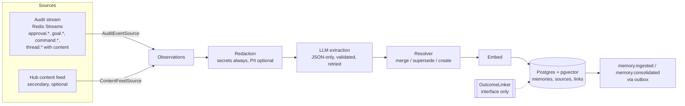
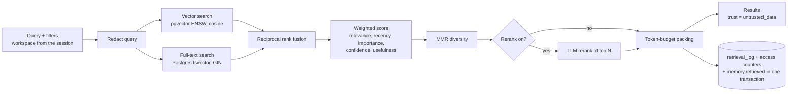
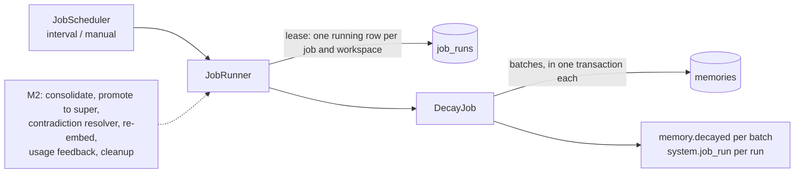

# Architecture

proba-memory is the memory service of Proba. It lives next to the audit service and the Hub, but it is a
separate system with its own store: **audit is the record of what happened, memory is what the system
learned from it.** Memory reads the audit stream (and other sources), writes to Postgres + pgvector, and
answers retrieval requests with scored, explainable results.

- Categories: `working`, `episodic`, `semantic`, `procedural`, `super`.
- Sources: goals, approvals, message threads, audit and analytics logs.
- Three parts: **ingestion and indexing** (apps/memory-ingestor), **background jobs** (apps/memory-jobs),
  **retrieval** with a configurable scoring formula (apps/memory-api).
- Built in M1: the foundation, the write path, retrieval, the read API and the **decay** job. Extension
  points exist for M2 (more jobs), M3 (evaluation harness) and M4 (portal screens); they are listed at the end.

## Layout and layering

```
packages/scoring     pure functions: scoring profile schema, normalisation, recency, RRF, MMR, token packing
packages/core        domain types, ports (interfaces), write path, retrieval service, audit emitter/outbox/relay,
                     config, logger, job runner, adapter registry. No I/O libraries.
packages/adapters    implementations of the ports: Postgres+pgvector, Redis Streams, OpenAI-compatible embedder
                     and LLM (DeepSeek preset), audit/content sources, auth, rate limiters, in-process versions,
                     and the registries that pick them by config
apps/memory-api      Fastify read API (search, get, list, profiles) + operator search CLI
apps/memory-ingestor sources -> write path; seed CLI
apps/memory-jobs     job scheduler and runner; decay job; run-job CLI
migrations/postgres  numbered SQL, applied by `npm run migrate`
```

Dependencies point one way: `scoring` ← `core` ← `adapters` ← `apps`. Apps never construct an adapter
directly: `createRuntime(config, { needs })` asks the registries for the adapter named in config and
only creates the ports the app asked for (the API has no LLM unless rerank is on, for example).

## Write path (ingestion and indexing)



Properties that the tests pin down:

- **Idempotent by observation id.** The id is a deterministic UUID of (source, external id). A claim state
  machine (`pending` → `processed` or `skipped`, with a claim so only one worker runs it) lets redeliveries and concurrent workers do nothing.
- **One transaction.** Memory rows, source links, supersede/contradict links, the vector index entries and the
  audit event commit together. If the audit event cannot be recorded, nothing is written and the observation
  stays pending for redelivery.
- **Redaction before anything leaves the process.** Secrets (API keys, tokens, passwords, private keys) are
  always masked; email and phone numbers are masked when `REDACT_PII=true` (default). The LLM and the
  embedder only see redacted text, the model's output is redacted again, and stored observations hold the
  redacted text. Conversation text from audit `content` is treated as sensitive: it goes only into the
  observation text, never into logs, audit events or `facts`.
- **Prompt hardening.** Observations are given to the model as JSON data with `<` escaped inside a single
  delimited block; the system prompt says the block is data; the model gets no tools. Its output must match a
  schema (no `super` category, ranges checked), otherwise the call is retried with the validation error and
  finally fails (the observation stays pending and is dead-lettered by the source after
  `BUS_MAX_DELIVERIES`).
- **Resolver.** Cosine similarity ≥ `RESOLVER_SIMILARITY_THRESHOLD` (default 0.9) against active memories of the
  same workspace and category is the same fact: same stance merges (evidence count +1, confidence up, clock
  reset), opposite stance supersedes (old memory `superseded` with `validTo`, `supersedes` and `contradicts`
  links). ≥ `RESOLVER_RELATED_THRESHOLD` (0.75) only adds a `supports`/`contradicts` link. Never hard-delete.
- **Delivery.** The ingestor acks after the pipeline finishes. A failure leaves the item pending; reclaim
  redelivers; after the maximum deliveries the source dead-letters it (the dead letter never keeps `content`).

### Audit `content` and the Hub content feed

Since protocol v0.3.3 an audit event can carry an optional admin-only `content` (raw text of user messages,
brain replies, clarifications and explanations, secrets masked, with a content digest). `AuditEventSource` uses it as
the **primary** source of conversation text: `thread.message_received`, `brain.reply_generated`,
`brain.explanation_generated` and `brain.clarification_requested` events become observations **only when
`content` is present**; without it they carry nothing to learn from and are ignored. Content of kind `prompt`
(model input) is never used. `approval.*`, `goal.*`, `command.*`, `control.*` and `brain.decision_made` are
observations from their structured fields as before.

The `HubContentSource` port stays, as a secondary source (`SOURCES=audit,content`).

#### Hub content feed: open question

Open question for the Hub team: **will the Hub expose a content feed?** It would add what audit events do not
hold: the wording of goals and approval requests/answers, and history from before `content` existed. Proposed
interface (read-only, workspace-scoped by the service credential, cursor-paged, ordered by `(occurredAt, id)`):

```
GET /internal/v1/content?workspaceId=<id>&after=<cursor>&limit=100
→ 200 { "items": [ ContentItem ], "nextCursor": "<opaque>" | null }

ContentItem {
  id, kind: "goal" | "approval" | "thread_message", workspaceId, occurredAt (UTC ISO 8601),
  goalId?, threadId?, userId?, author?: { type: "user"|"brain"|"system", id },
  text, decision?: "granted"|"rejected"|"expired"|"requested", sourceRef: "hub:goal/<id>"
}
```

Until it exists only a development source (`HUB_CONTENT_SOURCE=dev`, refused in production unless
`ALLOW_DEV_CONTENT_SOURCE=true`) is registered. Adding the real one is one adapter and one
`registries.hubContentSource.register('hub', ...)` call.

## Read path (retrieval)



- **Hard filters first.** Workspace (from the session, never the request), status (`active` unless an admin asks
  otherwise), category, goal, thread, confidence, time window.
- **Score** = Σ weight × feature, features in 0..1: relevance (fused rank score), recency (exponential decay by
  category half-life, measured from the last reinforcement), importance, confidence, usefulness.
  Default weights 0.5 / 0.15 / 0.15 / 0.1 / 0.1.
- **Profiles are data.** `scoring_profiles` holds immutable versions (weights, half-lives, fusion constants, MMR
  lambda, pool sizes, packing, rerank). A version moves `draft → shadow → canary → active → retired`. A shadow
  version is scored on every request and logged next to the served one but never returned; a canary serves
  `canaryPercent` of requests, chosen by a hash of the trace id. A workspace uses its own profile family once it
  has an active version, otherwise the global (`*`) one.
- **Every retrieval is logged** (`retrieval_log`): query (redacted) and hash, filter, profile and version, every
  candidate with its features, ranks, score, position or drop reason (`below_min_score`, `outside_pool`,
  `diversity`, `over_limit`, `over_budget`), results, and shadow results. It is audited as `memory.retrieved`
  with ids and counts only. The log row, the access counters and the outbox event commit together; if auditing
  fails the read fails (**fail closed**).
- **Degrades, does not break.** Vector index down → full-text results with `degraded: vector_search_unavailable`;
  rerank failure → score order with `degraded: rerank_unavailable`.
- **Retrieved text is untrusted data.** Every result carries `trust: "untrusted_data"`; consumers must treat it
  as data to quote, never as instructions. The API returns it as JSON and never interprets it.

## Background jobs



**Decay** lowers `confidence` and `importance` of active memories exponentially toward floors
(`DECAY_CONFIDENCE_FLOOR`, `DECAY_IMPORTANCE_FLOOR`), measured from the later of the last reinforcement and the
last decay, so runs do not compound and a run right after another changes nothing. Half-lives per category:
working 1 day, episodic 14, semantic 180, procedural 365, super 730 (`DECAY_HALF_LIFE_DAYS` overrides);
importance fades `DECAY_IMPORTANCE_HALF_LIFE_MULTIPLIER` (2) times slower. Rows moving less than
`DECAY_MIN_CHANGE` are skipped without resetting their clock. It never deletes, retires or changes content.
Adding a job means implementing core's `Job` and adding one line to `createJobs`; the lease, schedule, audit
events and logs come with the runner.

## Ports and adapters

Every external dependency is behind a port. The adapter is named in config; the default is in bold.

| Port | Config | Adapters | Notes |
| --- | --- | --- | --- |
| MemoryStore | `MEMORY_STORE` | **postgres**, memory | transactions, FTS search, observations, links, claims |
| VectorIndex | `VECTOR_INDEX` | **postgres** (pgvector HNSW cosine), memory | `memory` needs `MEMORY_STORE=memory` |
| ScoringProfileStore | `SCORING_PROFILE_STORE` | **postgres**, memory | versioned profiles |
| RetrievalLogStore | `RETRIEVAL_LOG_STORE` | **postgres**, memory | |
| JobRunStore | `JOB_RUN_STORE` | **postgres**, memory | lease via partial unique index |
| OutboxStore | `OUTBOX_STORE` | **postgres**, memory | audit outbox |
| EventBus | `EVENT_BUS` | **redis-streams**, memory | consumer groups, reclaim, dead letters |
| Embedder | `EMBEDDER` | **openai-compatible**, hash (local) | `EMBEDDER_BASE_URL`, `EMBEDDER_MODEL`, `EMBEDDING_DIMENSION` |
| LlmProvider | `LLM_PROVIDER` | **deepseek**, openai-compatible, scripted (local) | OpenAI-compatible HTTP |
| TokenCounter | `TOKEN_COUNTER` | **approx** | |
| JobScheduler | `JOB_SCHEDULER` | **interval**, manual | |
| OutcomeLinker | `OUTCOME_LINKER` | **noop**, memory | interface only in M1 |
| SourceAdapter | `SOURCES` (list) | **audit**, content | |
| HubContentSource | `HUB_CONTENT_SOURCE` | dev | the real Hub feed is an open question |
| TokenVerifier | `MEMORY_API_TOKEN_VERIFIER` | **firebase**, static | static refused in production |
| RateLimiter | `MEMORY_API_RATE_LIMITER` | **memory**, redis | |
| AuditEmitter | `AUDIT_TRANSPORT` | **outbox**, bus | see below |

The local stand-ins (`hash`, `scripted`, `dev`, static tokens) refuse to start with `NODE_ENV=production`
unless explicitly allowed (`ALLOW_LOCAL_EMBEDDER`, `ALLOW_SCRIPTED_LLM`, `ALLOW_DEV_CONTENT_SOURCE`).

### Swapping an adapter

1. Implement the port from `packages/core/src/ports` (the contract suites in `packages/core/src/testing` run
   against every implementation: `run*Contract('name', factory)`).
2. Register it: `registries.vectorIndex.register('qdrant', ({ config, logger }) => new QdrantIndex(...))` in
   `createDefaultRegistries()` or in your own registries passed to `createRuntime`.
3. Select it: `VECTOR_INDEX=qdrant`.

Embedder: set `EMBEDDER_BASE_URL`, `EMBEDDER_MODEL`, `EMBEDDER_VERSION` and `EMBEDDING_DIMENSION`; every memory
stores `embeddingModel` and `embeddingVersion`, and vector search only compares vectors of the same model and
version, so a model change is a re-embed job (M2), not a silent mix. Changing the dimension needs a migration
of the `vector(N)` column. Vector store: implement `VectorIndex` (and `MemoryStore` if text and structured
queries move too). Bus: implement `EventBus` (publish, subscribe, read/ack/reclaim/dead-letter), for example
Kafka. LLM: any OpenAI-compatible endpoint works through `LLM_PROVIDER=openai-compatible` with
`LLM_BASE_URL`/`LLM_MODEL`/`LLM_API_KEY`; `LLM_EXTRA_BODY` carries provider-specific switches.

### Audit emission (copied from proba-audit)

The `AuditEmitter`, the transactional outbox (`audit_outbox` table), the outbox relay and the Redis Streams
publisher are copied from proba-audit with **identical interfaces** (`createOutboxAuditEmitter`,
`createBusAuditEmitter`, `OutboxStore`, `OutboxRelay`, `EventBus`, `AUDIT_TRANSPORT=outbox|bus`). Events use
the `memory.*` actions of the catalog (`memory.ingested`, `memory.consolidated`, `memory.retrieved`,
`memory.decayed`) and `system.*` lifecycle actions; details carry ids, counts and lengths, never memory text.
Types come from `@smallseedlabs/proba-protocol` pinned to v0.3.3.

## Data model (Postgres)

| Table | Purpose |
| --- | --- |
| `memories` | one row per memory: workspace, category, content, summary, `embedding vector(N)` (HNSW cosine), generated `content_tsv` (GIN), importance, confidence, usefulness, status (`active`/`superseded`/`tombstoned`), `supersedes_id`, validity window, access and reinforcement counters, evidence count, goal/thread, source refs, provenance |
| `observations` | the idempotency ledger of the write path: id, source, redacted text, facts, signal, status, attempts |
| `memory_sources` | which observations created or reinforced which memory |
| `memory_links` | `supports`, `contradicts`, `supersedes` between memories, with weight |
| `scoring_profiles` | versioned profiles, one active per (workspace, name) |
| `retrieval_log` | every retrieval with candidates, features, profile version, results |
| `job_runs` | job executions and leases (one running per job and workspace) |
| `audit_outbox` | audit events waiting to be published |

Every query is scoped by `workspace_id`; there is no code path that reads across workspaces. Nothing is
hard-deleted: retiring is a status change.

## Security notes

- Workspace isolation comes from the session (`/v1/session`), not from request parameters; passing a workspace
  in the body, filter or query string is rejected. A memory id of another workspace answers exactly like a
  missing one.
- Sign-in uses Firebase ID tokens; access needs an allow-listed address or domain (viewer), admins see candidate
  tables, non-active memories and full profiles. Per-caller rate limits, an auth-failure limiter and throttled
  denial audit events.
- No write routes exist on the API.
- Logs are structured JSON with `traceId` on every line; secrets and memory or conversation text are not logged.

## Extension points for later milestones (not built)

- **M2 jobs:** implement `Job`, add to `createJobs`. Planned: consolidation, promotion to `super`,
  contradiction resolution, re-embedding, usage feedback, cleanup. `OutcomeLinker` (+ `buildOutcomeLink`) is
  the hook for linking approved actions to later metric changes (correlation with sample size, never causal).
- **M3 evaluation harness:** `retrieval_log` holds queries, candidates, features and profile versions; shadow
  profiles produce the comparison data; profile versions are immutable, so runs are replayable.
- **M4 portal screens:** `docs/openapi.yaml` is the contract; the API already returns scores, candidate tables
  (admin) and profiles.
